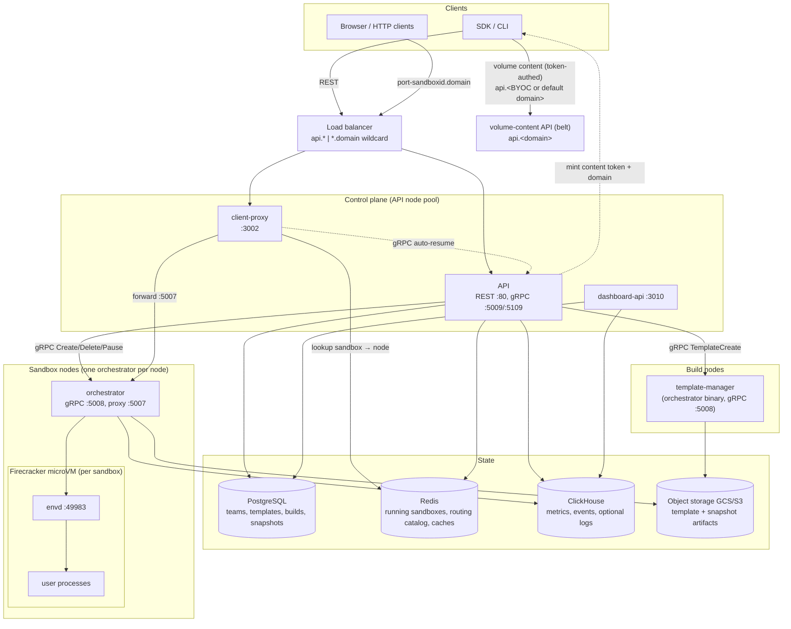
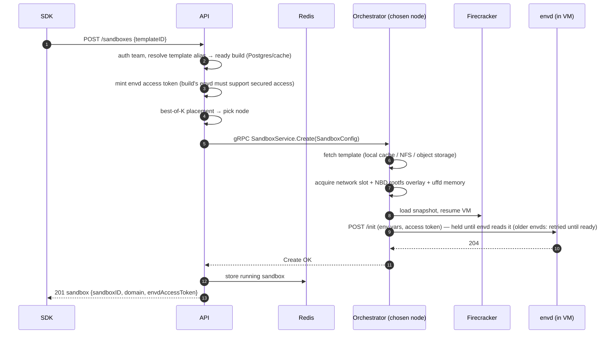
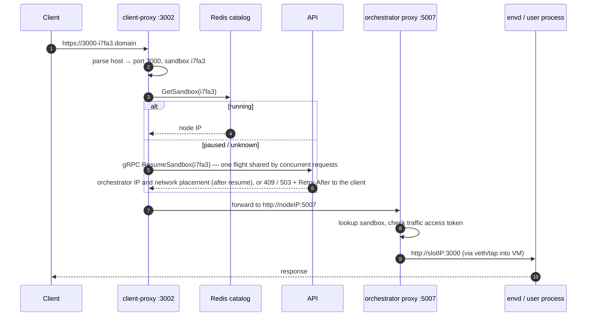
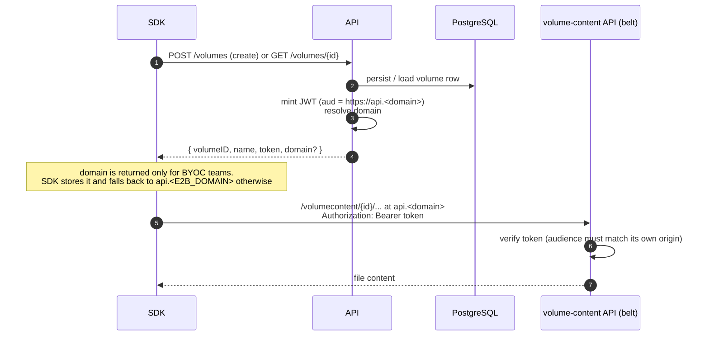
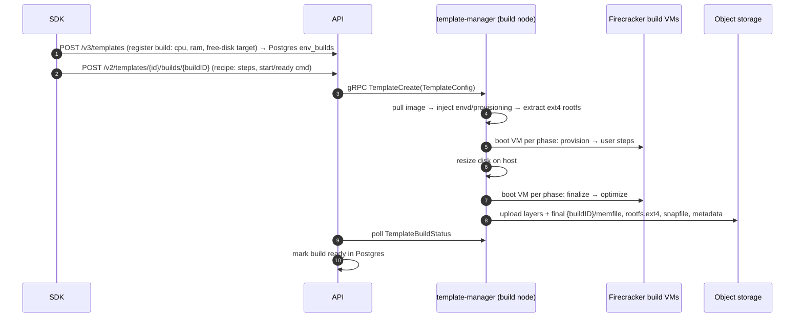
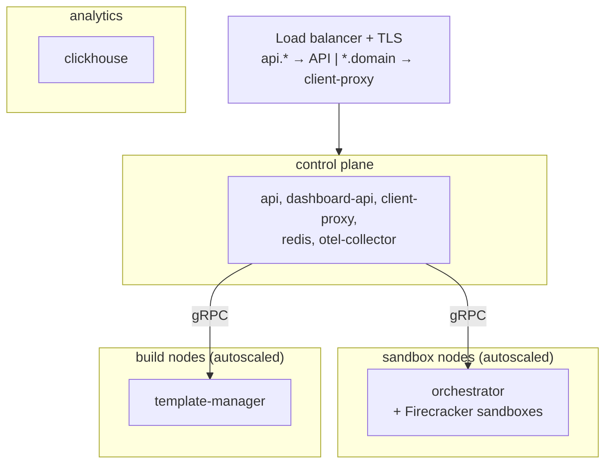

# E2B Infrastructure Architecture

This document explains what this repository implements, what each service does, and how the
services interact. It is the fastest way to build a mental model of the codebase before diving
into the code.

> **Keep this document updated.** If a code change alters anything described here (service
> responsibilities, ports, protocols, data stores, flows, deployment topology), update this file
> in the same PR.

## What this repository implements

E2B provides **sandboxes**: isolated Linux VMs that start almost instantly (they resume pre-booted
snapshots instead of cold-booting), run arbitrary code (typically
generated by AI agents), and can be paused, snapshotted, and resumed. This repo contains the whole
backend: the control-plane REST API, the data-plane VM orchestration built on
**Firecracker microVMs**, the in-VM agent, the edge routing layer, and template building.

Two ideas drive the design:

1. **A sandbox is a resumed snapshot.** Templates are pre-booted VM snapshots (memory + disk +
   VM state) stored in object storage. "Creating" a sandbox means restoring a snapshot, which is
   why startup is fast. Memory pages are loaded lazily on page-fault (userfaultfd) and the root
   filesystem is a copy-on-write overlay, so only touched data is ever fetched. A template can
   also be filesystem-only (rootfs, no memfile), taken by a filesystem-only pause or checkpoint;
   sandboxes created from it cold-boot from disk instead of resuming.
2. **Control plane and data plane are separate.** The API decides *where* a sandbox runs and
   tracks *that* it runs (Postgres/Redis); the orchestrator on each node owns *how* it runs
   (Firecracker, networking, storage). Sandbox traffic never passes through the API.

## System overview



## Services

| Service | Package | Runs on | Purpose |
|---|---|---|---|
| API | `packages/api` | API nodes | Public REST API; sandbox lifecycle, placement, auth, quotas |
| Orchestrator | `packages/orchestrator` | every sandbox node | Runs Firecracker VMs; sandbox create/pause/resume/kill |
| Template manager | `packages/orchestrator` (role) | build nodes | Builds templates from Docker images |
| Client proxy | `packages/client-proxy` | API nodes | Edge router: sandbox URL → correct node |
| Envd | `packages/envd` | inside every VM | In-VM agent: process/filesystem API for SDKs |
| Dashboard API | `packages/dashboard-api` | API nodes | Backend for the web dashboard (templates, builds, admin) |

Supporting packages: `packages/shared` (protos, telemetry, storage clients, feature flags),
`packages/auth` (authentication library), `packages/db` (Postgres migrations + sqlc queries),
`packages/clickhouse` (ClickHouse schema + clients), `packages/otel-collector` (collector config),
`packages/nomad-nodepool-apm` (autoscaler plugin), `packages/local-dev` (local stack).

### API (`packages/api`)

The control-plane entry point (Gin, OpenAPI-generated from `spec/openapi.yml`, port 80).

`PUT /unstable/management/projects/{projectID}/settings` applies a revisioned settings
projection from the owning management service. This endpoint belongs to the API
and accepts only service JWTs through `AdminJWTAuth`. It locks the team and checks
that it has not been deleted before applying the projection. The shared `ProjectSettings` type
contains `SandboxSettings`, with the optional ingress default under
`sandboxSettings.defaultAllowPublicTraffic`. Storage uses `projection.project_settings`,
with `revision` and nullable `sandbox_default_allow_public_traffic` in the same row.
The receiver applies both in one guarded upsert. Equal or older revisions cannot
overwrite it. Clearing stores NULL at a newer revision, retaining the ordering fence.
Cache invalidation follows commit and is retried on duplicate
delivery after a cache failure. There is no rollout flag check on accepted delivery.
Sandbox creation resolves an absent default to true and honors a saved default
independently of rollout eligibility. New sandboxes can use an older value while
delivery or cache refresh is pending.

- **Resources**: sandboxes (create/list/kill/pause/resume/connect/timeout/metrics/logs),
  templates and builds, teams, volumes, API keys, secrets, sandbox events and webhooks,
  admin operations.
- **Spec document**: `GET /openapi.json` serves, without authentication, the spec the request
  validator runs. An `ETag` over the document answers a matching `If-None-Match` with 304. It is
  registered before the validator, which rejects undeclared paths.
- **Auth** (via `packages/auth`): team API keys (`X-API-Key`, `e2b_` prefix), auth-provider JWTs
  (OIDC), and either an admin token or a service JWT verified from the configured admin JWKS.
  Backed by an auth DB (Postgres) with a Redis team cache.
- **API-group rate limits**: operations declare a group through the `x-api-group` OpenAPI
  extension. After authentication succeeds, its callback wrapper reads the validator's
  already-matched operation and stores the API group directly in Gin's context. The rate limiter
  reads that group and maps it to a field in the authenticated team's limits. Grouped operations
  require team-identifying authentication; public operations do not populate an API group.
  The `list` group uses `api_team_rps_list`; the `delete` group uses `api_team_rps_delete` only
  for sandbox and template deletion. Other DELETE operations are ungrouped.
  Delete rates default to zero until configured.
  A group's rate is one of the team's limits and resolves with the rest of them in the statement
  that loads the team, which authentication caches; it has no source of its own.
  Propagated project limits carry both rates, and each accepted revision replaces
  them. A team with no `project_limits` row uses the deployment's `default_limits`; zero
  disables group limiting. The migration that added `default_limits` gave every existing team a
  row holding its limits at the time, so a change to the defaults reaches only teams created since.
  A positive rate sets both requests per second and burst capacity. Redis enforces a separate
  budget for each team, HTTP method, and route template across API replicas: groups select
  rates, but routes do not share a budget. Exhausted budgets return HTTP 429 with rate-limit
  and `Retry-After` headers. Ungrouped operations and unconfigured rates bypass group limiting;
  Redis failures are logged and counted while requests proceed.
  V1 route limits from `rate-limit-config` are always enforced first. For requests that pass V1,
  LaunchDarkly's `rate-limit-v2-mode` is the master switch for all V2 checks, and
  `rate-limit-delete-mode` can further restrict delete checks. Both default to `disabled`;
  missing, invalid, or unknown modes are treated as disabled. Deletes skip V2 if either flag is
  disabled and enforce only when both are enabled. If both are active and either is `shadow`,
  deletes run in shadow mode. Lists follow the global mode.
  The groups use the same limiter logic: `shadow` observes V2 decisions while
  preserving V1 headers, and `enabled` also enforces V2. Ungrouped operations, unconfigured V2
  rates, and V2 Redis errors retain V1 enforcement. A rejection reports the rejecting limiter's
  headers; when both checks allow a request in enabled mode, V2 supplies the rate-limit headers.
- **Sandbox list snapshots**: a list request reads the team's whole sandbox index from Redis
  (its running and pausing records) and pages in memory, so with the LaunchDarkly
  `sandbox-list-max-lag-ms` flag set for a team, each API replica shares one read between
  that team's concurrent list requests and keeps it for the flag's value, counted from the
  start of the read; a request that joins a read already in flight gets that read's result
  however long it takes. A lowered flag applies to a live snapshot; a raised one from the
  next read. Within that lag a sandbox created, killed, paused or resumed can be missing from
  the list or shown in its previous state on the replica holding the snapshot, and one
  resumed inside it can appear on two pages of a walk served by different replicas. The
  default, zero, gives every request its own read with the same store commands as before.
  Only the two list endpoints use the snapshot; the evictor, reconcile, template delete and
  team teardown keep reading the store directly.
- **Workload identity**: sandbox create accepts an optional `iam.tokens` map of caller-named
  workload-token definitions (each an exact `audience` and `tokenType`). A non-empty, validated
  map enables workload identity, whose identity the orchestrator derives from the sandbox's
  already-authoritative team/sandbox/execution/template IDs; the definitions are passed to the
  orchestrator in `SandboxConfig.iam`. The API mints no credential and delivers nothing into the
  sandbox; file-based delivery is rejected at admission. Definitions are persisted in the
  running-sandbox (Redis) and paused-snapshot (Postgres) state so they survive pause/resume and
  orchestrator re-sync; a fork starts a new workload and does not inherit them.
- **Placement**: keeps a live map of orchestrator nodes (discovered via Nomad, Kubernetes, or a
  static list). Chooses a node per sandbox with a **best-of-K** algorithm
  (`internal/orchestrator/placement/`): sample K ready nodes, score by the
  higher of CPU load and hugepage-pool load, pick the lowest; retry on
  exhausted nodes. A node that refuses a create (`ResourceExhausted`) stays
  eligible, and each refusal waits a full-jitter backoff that doubles up to a
  cap, so a placement that finds every node busy does not re-send creates as
  fast as they are refused. The hugepage-pool load is measured against the node's
  base pool (`nr_hugepages`, allocated at boot), so a node that has borrowed surplus
  pages scores above 1 instead of reading as just full; a pool that is all overcommit
  is measured against its ceiling, and an orchestrator that does not report the base
  pool against `HugePages_Total` as before. A node that reports no pool scores 0.5. Hugepage scoring
  is on by default (`BEST_OF_K_HUGEPAGE_MEMORY`); set it false to rank on
  CPU alone. K, overcommit ratio, and alpha are tunable live via feature
  flags. With `placement-hugepage-limit-percent` above 0, a hugepage sandbox
  is also refused by any node whose committed hugepages would pass that share
  of the node's pool ceiling (base pool plus overcommit allowance, reported by
  the orchestrator); within an API replica the check and the in-flight record
  are one step per node, and when the compatible nodes are all full placement
  answers with a capacity error, not "no compatible node". With the
  orchestrator's `create-memory-refusal` flag on (`CREATE_MEMORY_REFUSAL` for a
  deployment without LaunchDarkly), a create whose guest memory the pool
  cannot back while a sandbox on that node is still tearing down is refused
  with `ResourceExhausted`, so placement retries the node once the pages are
  back; with nothing tearing down it fails at once and says why. Off, it fails
  as an internal error and the node is excluded.
- **State**: writes sandbox records to Redis (source of truth for *running* sandboxes). It does
  not write routing: client-proxy reads the orchestrator-written `sandbox:routing:{id}` (see
  "Sandbox routing records"). Persistent entities (templates, builds, snapshots, teams) live in
  Postgres.
- **Secrets**: `/secrets` is the only public surface for secret management (create, list, get,
  update, delete). The API authenticates the caller with the customer alternatives above, converts
  the authenticated team UUID to the project UUID the backend knows, checks the `customer-secrets`
  feature flag, and forwards a metadata-only request over a unary gRPC contract
  (`e2b.secretsstore.management.v1`) to the secrets store backend named by
  `SECRETS_STORE_BACKEND_GRPC_ADDRESS`. No caller credential, header or client-supplied tenant
  crosses that hop, and no response - here or in a log, a span or an error - carries a secret
  value. What a caller stores is a runtime marker, not a resolved secret; orchestrator-ee resolves
  a marker to a value at sandbox egress, never here. Without a configured address, or with the flag
  off, the routes stay registered and answer 403. Responses are `Cache-Control: no-store`, request bodies are capped at 512 KiB, and values
  at 64 KiB. A create carries the cap on live secrets the backend enforces: `max_secrets` is one
  of the team's limits and resolves with the rest of them in the statement that loads the team (its
  `project_limits` value, else the deployment's `default_limits`).
- **Sandbox events and webhooks**: `/events/sandboxes` reads a team's sandbox lifecycle events,
  and `/events/webhooks` manages the webhook subscriptions those events are delivered to, along
  with each subscription's delivery attempts and delivery statistics. The API stores none of
  this: it authenticates the caller, resolves the team's cluster, and forwards the request over
  two unary gRPC contracts (`e2b.webhooks.events.v1` and `e2b.webhooks.management.v1`) to the
  backend named by `WEBHOOKS_BACKEND_GRPC_ADDRESS`. The team and cluster come from the
  authenticated context, never from the request, and a team with no cluster selects the local
  one. Without a configured address the routes stay registered and answer 503, so the surface
  does not depend on how a deployment is wired. A backend failure the caller cannot act on is
  answered with the endpoint's own message; the outcomes that keep their identity are
  not-found, a rejected request, the webhook-count limit, and a timeout. A create or update
  body carries the webhook's signing secret, so a request rejected before the handler has its
  body kept out of the response, the access log and the span. Reads are capped at 100
  deliveries per page.
- **Rig passthrough**: admin endpoints under `/clusters/{clusterID}/rigs` manage a cluster's
  orchestrator node pools ("rigs"). They list rigs, change rig capacity, list and terminate
  instances, and read recent scaling errors. Every handler delegates to the cluster's edge service
  (`/v1/rigs/...`) through the per-cluster HTTP client that the cluster sync keeps fresh. The API
  holds no cloud credentials and makes no scaling decisions. The caller authenticates with an
  admin credential and never holds the cluster's edge secret. Edge status codes pass through unchanged
  (400, 404, 409, 501). An edge 401 becomes a 500: it means the API is misconfigured against the
  cluster, not that the caller's token is invalid. A cluster with no rig management configured
  returns an empty list. The local cluster has no edge deployment and answers 501 for every rig
  operation.
- **Extra listeners**: internal gRPC :5009 and edge gRPC :5109 expose `ResumeSandbox` so
  client-proxy can wake paused sandboxes on incoming traffic.
- **Outbox** (`internal/outbox`): a River client on the shared database's `river` schema
  works jobs that other services enqueue there for work needing the orchestrator
  connections. Its job arguments live in `packages/db/pkg/outbox`. The one kind today,
  `teardown_team_resources`, stops a deleted team's workloads; dashboard-api enqueues it when
  it deletes a project. A guard runs first on every
  attempt: a team that exists and is not blocked fails the attempt, and the job retries rather
  than kill a live team's sandboxes; a missing team row does not stop it. Then
  `kill_sandboxes` kills the team's running sandboxes and succeeds only once the sandbox store
  holds none of them in any state, so a sandbox still pausing or being killed makes the job
  retry. A sandbox that is not running cannot be paused, so no new snapshot of the team
  appears afterwards. Killing through the orchestrator is what removes the sandboxes' store
  records, so the job deletes no Redis state itself, and every attempt is safe to run again.
  Builds are not cancelled: they end on their own build timeout. An attempt is bounded at
  30 minutes; retries back off from 30 seconds to a 15-minute cap, so the 100 attempts last
  about a day before River discards the job and keeps it. Volumes, templates, snapshots and
  the team row are left alone. Steps report
  `api.outbox.steps.finished` and `api.outbox.step.duration`; finished jobs report
  `outbox.jobs.finished`, and the backlog reports `outbox.jobs` and `outbox.oldest_*_age`.
  `OUTBOX_MAX_WORKERS` (default 10) and `OUTBOX_BACKLOG_INTERVAL` (default 30s) configure it;
  shutdown stops it after the sandbox-work drain, before the database and Redis clients close.
- Reads ClickHouse for sandbox/team metrics endpoints. Sandbox and template-build logs default to
  Loki, with a LaunchDarkly-gated ClickHouse read path (`logs-read-config`) for local-cluster logs
  during the log storage migration. `LOKI_URL` is optional: without it the api has no Loki client
  and those reads fail until the flag routes them to ClickHouse. `LOGS_READ_CONFIG=true|false` sets
  the value the flag falls back to when LaunchDarkly has none (no LaunchDarkly, or the flag not
  defined there); a LaunchDarkly value wins. LaunchDarkly feature flags also gate placement
  parameters, rate limits, and rollouts.

### Orchestrator (`packages/orchestrator`)

A single Go binary running on every sandbox node (as root). `ORCHESTRATOR_SERVICES` selects its
roles: `orchestrator` (run sandboxes) and/or `template-manager` (build templates). Code lives
under `pkg/`, almost all Linux-only.

gRPC services on :5008 (`pkg/server/`, `pkg/service/`, `pkg/template/server/`, `pkg/volumes/`):

- **SandboxService** — `Create`, `Update`, `List`, `Delete`, `Pause`, `Checkpoint`.
  `Update` callbacks are serialized per sandbox. A successful transition out of the live
  map closes update admission and joins any admitted callback before stop/checkpoint
  work or stopping notifications begin; `Close` repeats that check for crash cleanup.
  An update using an inactive sandbox returns gRPC `NotFound`, which the API maps to
  HTTP 404 for timeout and network updates. Teardown waits for admitted callbacks;
  it cannot preempt one that does not return.
- **TemplateService** — `TemplateCreate`, `TemplateBuildStatus`, `TemplateBuildDelete` (template-manager role only).
- **InfoService** — node identity, roles, capacity, health status (used by API node discovery).
- **ChunkService / VolumeService** — peer-to-peer template chunk serving; persistent volumes.

Process shutdown, triggered by `SIGINT`, `SIGTERM`, `SIGUSR1`, or a service failure, moves
the node to `ShuttingDown` before draining builds and sandboxes. Like `Draining`, this excludes new
placement while existing work stays reachable, and `/health` returns HTTP 200 with status
`draining`. Unlike reversible `Draining`, `ShuttingDown` is terminal for the process;
status overrides cannot enter or leave it. `FORCE_STOP` skips waiting for sandboxes to exit.
The sandbox drain ends only when no sandbox is live and the node's outstanding work (below) is
zero, so a create or a resume-fresh checkpoint in flight, whose sandbox is briefly not live, holds
it until its sandbox goes live and then ends.

After sandbox drain and snapshot uploads complete, sandbox proxy cleanup attempts graceful HTTP
server shutdown with a separate deadline, then forces server closure if needed. Successful forced
closure recovers graceful deadline expiry; other server errors still propagate. Pprof stays
available through service teardown; its final shutdown also has a deadline and forced-close fallback.

`InfoService.ServiceInfo` reports `outstanding_work` for sandbox, template-builder, and
mixed-role nodes. It counts overlapping work holds, not distinct sandboxes or builds, and includes
tracked background persistence and cleanup. The producer reports zero when idle. The API caches
this report and exposes it as required top-level `outstandingWork` in admin node list and detail
responses, where zero also covers a node that has not reported. This observational count does not
by itself authorize node deletion.

`InfoService.ServiceInfo.max_sandboxes` reports the cached node limit for every service role.
Admin `/nodes` and `/nodes/{nodeID}` return required `maxSandboxes`, including zero. Admission,
metrics, and node info share the value refreshed from node-scoped flags every 30 seconds.

Key mechanisms (all under `pkg/sandbox/`):

- **Firecracker** (`fc/`): each sandbox is one Firecracker process in its own cgroup and network
  namespace. The FC HTTP API (unix socket) configures machine, drives, network, and snapshots.
  Guest metadata (sandbox ID, envd access token hash) is passed via MMDS.
  A sandbox may use fewer CPUs than its VM has (`SandboxConfig.max_vcpus` above `vcpu`): the VM
  is created with `max_vcpus` vCPUs, a boot puts `maxcpus=<vcpu>` on the kernel command line, and
  the `fc_vcpu` threads are held to `vcpu` CPUs by a `cpu.max` quota in a threaded `vcpu` child of
  the sandbox cgroup, so the VMM's own threads stay outside it. The quota is in place before the
  guest runs an instruction: a boot limits the whole cgroup until the vCPU threads exist and then
  moves the limit onto them; a resume confines the paused threads before the VM resumes, falls
  back to the whole cgroup, and fails if neither holds. The snapshot's metadata records the VM's
  vCPU count (`vcpu_count`, stamped at build and on every pause), so a resume limits below it
  without trusting the request or discovering capacity from cgroup threads. A legacy snapshot
  carries its stored original vCPU count as `max_vcpus`; if unavailable, it may only resume at its
  unchanged `vcpu`.
  `/init` carries the count as `cpuCount`
  so envd onlines or offlines guest CPUs to match and reports the outcome on `X-Envd-Cpus` and
  `/metrics`.
- **Lazy memory / UFFD** (`uffd/`): on resume, Firecracker restores the VM without loading
  memory; a userfaultfd handler serves page faults directly from the template's memfile, so only
  touched pages are read. An optional prefetcher warms known-hot pages.
- **Copy-on-write rootfs** (`rootfs/`, `nbd/`, `block/`): the template rootfs stays read-only;
  writes go to a per-sandbox COW cache exposed to Firecracker as an NBD block device served by
  an in-process userspace NBD server. On pause, the dirty blocks are exported as a diff.
- **Template cache** (`template/`): templates are fetched lazily from object storage and cached
  on local disk (and optionally on a shared NFS chunk cache, or fetched peer-to-peer from other
  nodes before upload completes). Every reader of a cached template holds a pin on it — a
  running sandbox, a build, a peer stream, an ancestor lookup — and eviction never closes a
  pinned template. A snapshot's own upload holds a pin while it runs and records on the entry
  whether the snapshot landed in storage; a layer that did not land is never released, so a
  failed upload's local copy stays until its TTL expires. When a pause, or a
  checkpoint that resumes a fresh sandbox, publishes a new layer, the layer its sandbox ran
  from is marked superseded if this node inserted it for an earlier pause, because no resume
  can ask for it again. With `snapshot-cache-release-superseded` and
  `snapshot-cache-ancestor-storage-fallback` both on, a superseded layer is released once no
  pin holds it, its devices have resolved and its upload has landed, instead of staying until
  its TTL expires. A descendant's upload then heals that ancestor's build data from storage,
  and writes the same header bytes it would have written with the ancestor still cached.
  The sandbox and template caches start empty after a restart: the template cache empties the
  build-data directory, and startup reclaim empties the sandbox, template and template-build
  scratch directories.
- **Networking** (`network/`): each sandbox gets a slot — a network namespace with a veth pair
  and a tap device, unique host-side IP (from a /16), NAT, and per-slot nftables egress firewall
  (with SNI/Host-inspecting TCP firewall for domain allow/deny lists). Slots are pooled and
  reused; slot indexes are allocated locally against the node's netns state (leftover
  namespaces from a previous run are torn down by startup reclaim).
- **Sandbox proxy** (:5007, `pkg/proxy/`): reverse-proxies incoming traffic from client-proxy to
  the sandbox's slot IP and requested port over HTTP or configured HTTPS, enforcing per-sandbox
  traffic access tokens through the shared ingress policy. HTTPS backends may use self-signed certificates.
  It refuses a full-router sandbox with 503 `sandbox_feature_unsupported` before dialing the
  slot.
  Each admitted lifecycle owns its proxy handlers and backend sockets, including pending dials
  and upgrades. Stopping seals admission and interrupts connections; network release waits for
  that work to finish. Restarting envd resets the owner while allowing the live lifecycle to
  admit a replacement. Retired streams have one second to write their terminal response before
  a stalled frontend is interrupted.
  Shared proxy shutdown waits for H2C and upgraded connections to close and includes them in
  forced connection cleanup. Failed H2C handshakes release their hijacked connections when the
  handshake handler returns.
- Writes sandbox lifecycle **events** and cgroup **host stats** to ClickHouse; exports metrics via
  OTel. Sandbox and template-build log writes go through a flag-resolved HTTP route: the legacy
  collector remains the fallback primary destination, and configured shadow destinations can mirror
  writes during collector/storage migrations without changing sandbox behavior.

Detached sandbox-event publication holds node work until the publisher returns. This covers
delivery attempts, not end-to-end delivery: the ClickHouse target enqueues into an in-memory
batcher, whose flushing remains part of shutdown.

### Envd (`packages/envd`)

The agent inside every VM (started by systemd very early in boot), port 49983, chi + Connect RPC.

- **Process service** (`spec/process/process.proto`): start/list/connect to processes, stream
  stdout/stderr, stdin, signals, PTYs — this is what SDKs use to "run code". A start is refused
  with `unavailable` while the workload cgroups are frozen for a pause, and the freeze waits for
  in-flight starts, so a pause does not capture a child stopped before exec in a frozen cgroup. A
  start into a cgroup the guest froze itself is refused the same way. Starts carrying the system
  tag are unaffected: they stay in envd's own cgroup, which no freeze covers.
- **Filesystem service** (`spec/filesystem/filesystem.proto`): stat/list/make/move/remove/watch.
- **REST**: `/health`, `/metrics`, `/envs`, `/files` upload/download, `/init` (orchestrator pushes
  env vars, access token, metadata and the online CPU count after boot/resume), `/upgrade` (live self-upgrade, below),
  freeze/thaw hooks used during pause.
- **Public vs. control-plane routes**: the control routes (`/init`, `/collapse`, `/upgrade`, and the
  freeze/thaw hooks) are marked `x-internal: true` in `spec/envd.yaml`, and `/upgrade` — which the spec does not
  describe — is listed alongside them in the orchestrator's `pkg/sandbox/envd`. The orchestrator
  reaches them over the host network at the sandbox slot IP; the sandbox proxy refuses them with a
  404, for every method, so they are not reachable through a sandbox URL. Adding a control route
  therefore means marking it in the spec (`go generate` carries the marker into the proxy's
  rejection list) — otherwise it ships reachable from the internet.
- **Guest trust** (`internal/host/cacerts.go`): `/init` supplies the desired CA bundle.
  envd atomically records its PEM and owned DER identities in `/run/e2b/ca/state.json`,
  then publishes a complete replacement of the active bundle with the requested roots
  before returning. Ordinary installs copy the existing bundle without decoding it;
  recovery first repairs interrupted writes. All supplied identities are owned,
  including identical preexisting copies. A background loop resumes saved intent at startup
  and retries cleanup every second. It atomically removes retired roots from the active
  bundle before rootfs work, so source-file failures cannot delay that cleanup.
  It persists each requested certificate as
  `e2b-<SHA-256>.crt` in `/usr/local/share/ca-certificates`, removes retired managed files,
  and retains retirement identities until both bundle and source cleanup succeed.
  Superseded cleanup cannot publish an older bundle. Legacy-file removal checks the latest
  desired roots under the init lock, preserving hash links to a still-requested certificate.
  State survives envd process restart,
  not guest reboot. Retired roots may be trusted until cleanup succeeds, and an independent
  trust-store rebuild can restore a copy from a customer source file. Applications that
  cached their trust store must reload it.
- **Auth**: `X-Access-Token` header checked against a token delivered via Firecracker MMDS;
  signed URLs for file endpoints. `/init` is exempt (it is what *delivers* the token), which is the
  main reason the proxy refuses it outright.
- **Live upgrade** (`internal/services/process/upgrade.go`): an authenticated `POST /upgrade` lets
  the orchestrator swap envd inside a *running* sandbox at resume. It streams the new binary in the
  request body and envd `syscall.Exec`s into it **with the same PID**, carrying the workload's
  stdio/PTY fds, process table, recently-retained exit codes and filesystem watchers forward via a
  tmpfs handover blob. The workload cgroups stay frozen until the post-upgrade `/init` restores the
  access token (so no re-adopted process runs unauthenticated), and the handover outcome
  (procs/watchers re-adopted, plus any failures) rides back on that `/init`'s `X-Envd-Handover`
  header for fleet visibility.
- Scans guest ports and forwards them so any port a user process opens becomes reachable through
  sandbox URLs. **`pkg/version.go` carries the released version**, maintained by release-please from
  the Conventional Commits merged since the last envd release; do not edit it by hand. The API and
  the orchestrator gate features on the envd version recorded in each template build — the
  orchestrator's held `/init` is the one gate that reads the version of the envd expected to
  answer instead (see sandbox creation) — so a behavioral change ships under a `feat`/`fix`
  commit type that cuts a version it can be gated on.

### Client proxy (`packages/client-proxy`)

The stateless edge for all sandbox traffic (port 3002; health on 3003). Terminates
`https://<port>-<sandboxID>.<domain>` requests (host parsing in `packages/shared/pkg/proxy/host.go`),
looks the sandbox up in the Redis routing record to find the owning node, and reverse-proxies to
that node's orchestrator proxy on :5007 by default. `ORCHESTRATOR_PROXY_PORT` selects a
different downstream port when the node proxy listens elsewhere. If the sandbox is not in the record (paused), it calls
the API's `ResumeSandbox` gRPC — paused sandboxes wake transparently on traffic.
The record is the orchestrator-owned `sandbox:routing:{id}` (see "Sandbox routing records"
below).

The record on a hit, or the `ResumeSandbox` answer on a miss, is the sandbox's route, placement
included. A miss uses the resume answer directly and does not read the record again. A legacy
(no placement) or egress-router route goes to `orchestrator_ip` on the orchestrator proxy port,
never to the placement's ingress endpoint. A full-router route answers 503
`sandbox_feature_unsupported` without a Retry-After header and before anything is dialed. An
unknown mode or a missing `orchestrator_ip` answers the not-found page.

Concurrent requests that miss the record for the same sandbox, port and credentials share one
**resume flight** per client-proxy process: the first request's call runs detached from its
connection under a 90 s ceiling and later requests join it, so one resume RPC serves them all
and a client that disconnects mid-resume does not fail the others. A call whose requests have
all left runs to its end, so a client that comes back finds the sandbox awake, but no further
attempt starts for nobody, and a process keeps at most 64 such callerless calls; beyond that a
departure cancels the proxy's call. That bound and that cancellation apply to the proxy's flights
only: the API's resume entry point lets a create already under way run on past the proxy's
cancellation, so the node finishes the create and the API registers the sandbox inside the
reservation's 90 s window (the create may run until ten seconds before the pending reservation can
be reaped and the registration until five seconds before, so the run-on never lets a fresh
reservation start a second resume of the same snapshot), and the API's shutdown drain waits for
that work, bounded at 95 s. The run-on is granted when the resume is admitted, and an API already
draining admits none: a resume that arrives then keeps its caller's cut, so a create the proxy
cancels mid-drain is cut with it and the reservation lapses. The sandbox otherwise lives its
ordinary timeout or auto-pause, billed, with nobody waiting for it. With
`client-proxy-resume-parking` on (default off), a request whose flight got a still-transitioning
or `Unavailable` answer parks instead of failing: the flight retries
while a parked request waits, under a budget (`client-proxy-resume-parking-budget-ms`, 15 s from
the first retryable failure) that gates only whether another retry starts: every attempt, a late
retry included, runs under its full 90 s ceiling while a caller waits on it, so a parked request
can wait up to the budget plus one attempt. The proxy cuts a retry at the budget's end only once
every caller has left, and that cut ends the proxy's wait, not the create on the node.
A process keeps at most
`client-proxy-resume-parking-lot-size` (512) parked requests, shedding the rest. A resume the
control plane cannot carry out right now (no capacity, no node, the API unreachable, the budget
spent) answers **503** with `Retry-After: 2` and no error code; a request shed because the lot was
full answers the same **503** without the header and with `proxy_parking_lot_full` as its
`error_code`, so a client, or one behind an ingress that strips the header, still tells the two
apart. The SDKs do not act on the header either way: their status-based retry
wraps only the control-plane API client, and sandbox traffic through the proxy is retried only on
a connection failure, never on a 503. The omission is for hand-rolled retry loops and browsers
that honour the header, which would otherwise come back in one wave while the lot is still full,
and for a client that does the SDKs' jittered backoff on its own; a placement no retry helps, which
the API names in an `ErrorInfo` detail on the RPC status, is not retried and answers without the
header, with the status the API carried: **503** for a feature no orchestrator in the cluster
supports, **500** (`sandbox_create_refused`) for a sandbox the node refuses to create, such as a
stored build whose vCPU count is outside the node's bounds; a sandbox still pausing
answers **409** with the header on a user port and the same page as **503** on the envd port (the
SDK reads an envd 409 as "already exists"); a request whose client left before it was routed
answers 408.

### Dashboard API (`packages/dashboard-api`)

A separate REST service (port 3010, spec `spec/openapi-dashboard.yml`) consumed by the web
dashboard, not the SDK: template tags, build listings, and admin profiles. Its admin
routes accept either a shared admin token or
a short-lived service JWT verified against the configured admin JWKS. Team-scoped template and build read routes accept either dashboard user auth or
team API key auth (`X-API-Key`). Its workspace-agnostic `/v1/management` operations are defined in the
same dashboard OpenAPI contract and registered on the existing router. Their `AdminJWTAuth`
OpenAPI security scheme accepts only short-lived service JWTs verified against the workspace-api
`/.well-known/jwks.json` endpoint, with accepted signing methods derived from each JWK's required
`alg` metadata. Issuers and audiences are configured through the JSON `ADMIN_AUTH_PROVIDER_CONFIG` value —
the same config shape as `AUTH_PROVIDER_CONFIG`. Talks to Postgres and ClickHouse; never talks to
orchestrators. The web dashboard itself is a separate repository (github.com/e2b-dev/dashboard)
published as an image; E2B Embed runs it on port 3001 beside dashboard-api.

An issuer normally configures at least one accepted audience, binding a JWT to its intended target.
An issuer may omit `audiences` only with no `audienceMatchPolicy`; this deliberately disables
audience matching while issuer, signature, and temporal-claim verification remain required.

The `/v1/management` operations are the cluster's half of a contract the workspace residency owns:
project upsert (a project is a `public.teams` row created from a caller-supplied UUID; the tier is
assigned once at creation from a local default and no push moves it; an optional cluster ID is
stored on the project, with omission preserving its current assignment; a changed slug renames the project and, in the same transaction, gives each of its namespaced
template aliases under the new slug as well, keeping the old ones and leaving an alias the new
slug already holds as it is), per-member projection,
and limit sync (into `project_limits`, which the team lookups read in preference to `default_limits`). All are
idempotent, because the caller is level-triggered and retries. `PUT
/v1/management/projects/{projectID}/members/{userID}` applies the desired presence for one user,
gated by a monotonic per-project/user revision stored in `projection.project_members`; duplicate or
older revisions succeed without changing target state. `PUT
/v1/management/projects/{projectID}/limits` is gated the same way, by a monotonic per-project
revision in `projection.project_limits`: the caller raises it whenever the limits it resolved for a
project change, and a delivery at or below the recorded revision is dropped and still answers 204.
The ledger and the values in `public.project_limits` advance in one transaction, so a revision is
never recorded without the values it admitted. Both fences are the target's, and both exist for the
same reason — the caller can only fence what it sends, so two deliveries in flight arrive in
whichever order the network gives them and the older one has to be refused where it lands. A present projection includes that User's
OIDC issuer/subject identities. Every projected user has at least one identity, and an identity
already owned by a different user returns 409. A revocation removes only that User's
`users_teams` row; projected Users and identities are retained. Membership writes live in
`internal/management` with their post-commit cache eviction rather than in the handlers: auth
caches member authorization, so each accepted command invalidates that User's authorization for
the Project after commit.

`PUT /v1/management/projects/{projectID}/block` applies a revision-fenced block
state. The `projection.project_blocks` revision and `public.teams.is_blocked` /
`blocked_reason` commit together. Older or duplicate revisions leave stored state
unchanged. Every accepted delivery invalidates the team auth cache; eviction
failures return an error so retries can finish invalidation after commit. The API
uses this state when admitting billable work. It is the only route that writes the
team's block state.

Limit and block deliveries may carry `decided_at`, when the caller decided that
revision. The ledger row stores it beside the revision. Each delivery the ledger
accepts records the seconds since then in `dashboard-api.management.apply_lag`, by
`projection` (`project_limits`, `project_blocks`); one without `decided_at` counts
in `dashboard-api.management.origin_unknown` instead, never as zero lag. Dropped,
refused and failed deliveries record nothing.

The management surface also owns a replay-safe cluster lifecycle. A caller registers a stable
cluster UUID, assigns it only to the named project, detaches that exact assignment before provider
cleanup, and deletes the cluster only after no project references it. Replaying the same
registration or assignment succeeds. Registering the cluster again with the same name and auth
organization may change its endpoint, TLS setting, sandbox proxy domain and token, for example when
the cluster moves to a new domain; the API rebuilds that cluster's clients on its next sync and gives
sandboxes the new domain. A changed name or auth organization, a different assignment, an inexact
detach, or deletion of a referenced cluster returns a conflict. The
assignment does not check the project's tier; the caller decides which projects may use a cluster.
A cluster first registered through this surface starts without deletion protection; one created any
other way starts protected, a later registration never changes it, and deleting a protected cluster
or checking its destroy readiness returns a conflict.
A caller that deletes a cluster's projects before the cluster first lists them with
`GET /v1/management/clusters/{clusterID}/projects`, which returns every project whose team is
assigned to the cluster however it was assigned, leaving out deleted teams, and records the deletion with
`PUT /v1/management/clusters/{clusterID}/deletion` before deleting any of them. That request
locks the cluster row, returns a conflict while deletion protection is on, and sets
`clusters.deletion_requested_at`; it succeeds for an absent cluster and on repeat. From then on a
check constraint keeps deletion protection off, and a trigger on `teams` refuses to newly assign a
team to the cluster (`cluster_assignment_cluster_deleting` from the assignment route, a conflict
from an upsert carrying the cluster ID). The trigger takes a key-share lock on the cluster row
before it checks, so an assignment either commits before the deletion is recorded, where the
caller's next listing finds it, or is refused. Deleting each project clears its team's cluster,
the cluster delete clears it from any team deleted earlier, and then succeeds.
The shared error response supports an optional `error_code`, defined by the dashboard OpenAPI
`ErrorCode` schema. Registration and assignment rejections currently populate it; other errors
may omit it. Callers use that stable code rather than the human-readable message, and treat
uncoded or unknown reasons as generic errors.

`DELETE /v1/management/projects/{projectID}` soft-deletes any project, including a member's
default project; whether a project may be deleted is the caller's decision. `envs`,
`snapshots` and `volumes` reference `teams` with `ON DELETE NO ACTION`, so the team row
stays. One transaction locks the row (404 if it is missing), sets `teams.deleted_at`,
blocks the team (a CHECK keeps every deleted team blocked), clears its
cluster assignment, scrubs its name and email to `DELETED` and its slug to
`deleted-<project ID>` (releasing the old slug for reuse), deletes its memberships and API
keys, soft-deletes its templates, snapshot templates and paused-sandbox snapshots the way a
template deletion does (releasing their aliases and build tracking), and enqueues the API's
`teardown_team_resources` outbox job with River's `InsertTx`, so the teardown runs exactly
when the deletion commits. dashboard-api holds an insert-only River client for this; it works
no jobs. After commit it evicts the deleted keys' auth cache entries best-effort; the team's
other cached entries refresh or expire on their own. Repeating the call answers 204 and runs
every step again, keeping only the first deletion's time: it re-blocks and re-scrubs the team
and clears its cluster, undoing a block reason, rename or cluster assignment (from the cluster
route or an upsert carrying a cluster ID) written by a delivery that passed its
deleted-project check just before the first call committed; it deletes memberships, keys and
envs created since (a sandbox that paused before the teardown killed it leaves a snapshot);
and it enqueues the teardown again, which is a no-op while one is still open. Afterwards a
dashboard-api middleware, running after authentication, answers 404 to every write under
`/v1/management/` or `/admin/` that names the project by `projectID` or `teamID` (project
upsert, member, limits and block deliveries, cluster assignment and detachment, admin ban);
the project DELETE is exempt so a retry still reaches it. Shared auth refuses a
membership or API key still left for the project with 403, and the API leaves it out of a
user's team list. Volumes, builds and stored artifacts are not reclaimed.

## Data stores

| Store | Owner packages | What lives there |
|---|---|---|
| **PostgreSQL** | `packages/db` (goose migrations, sqlc) | Durable control-plane state: `teams`, `users`, `default_limits` (the one row of quota defaults), `project_limits` (per-team quota overrides pushed in by the owning service; the team lookups read it in preference to `default_limits`), `tiers` and `addons` (read for limits only by the legacy `team_limits` view), `envs` (templates), `env_builds` (build rows: vcpu, ram_mb, status, versions), `env_aliases`, `snapshots` (paused sandboxes), `team_api_keys`, `volumes`, `clusters` |
| **Redis** | API, client-proxy, orchestrator | Ephemeral runtime state: running-sandbox store (source of truth), sandbox→node routing catalog, team/template/snapshot caches, rate limiting, P2P chunk peer registry |
| **ClickHouse** | `packages/clickhouse` | Time-series/analytics: `metrics_gauge`/`metrics_sum` (written by the OTel collector), `sandbox_events`, `sandbox_host_stats` (written by orchestrator), team metrics, and optionally `sandbox_logs` during the log migration. Read by API and dashboard-api |
| **Object storage** (GCS/S3/local, `packages/shared/pkg/storage`) | orchestrator, template-manager | Template & snapshot artifacts, keyed by build ID: `{buildID}/memfile`, `{buildID}/rootfs.ext4`, `{buildID}/snapfile`, `{buildID}/metadata.json` + `.header` index files |

The API and dashboard-api share `packages/db/migrations`, tracked in PostgreSQL's
`_migrations` table. This includes `env_defaults`, which migration `20260915204740`
creates on fresh databases and adopts where it already exists, preserving its data.
Any existing `_dashboard_migrations` table is retained as historical bookkeeping and
requires no updates. Run the db-migrator before deploying updated services to a
database that lacks the table; no separate dashboard migration runner is needed.
Rolling back this migration retains the table and its data.

The same database holds River's job tables in the `river` schema, which a goose migration
creates. The db-migrator applies the goose migrations and then River's own, under one advisory
lock; `make migrate` runs it, because the goose CLI cannot apply River's. At startup the API and
dashboard-api refuse a database whose goose version is older than the one they were built against,
or whose River migrations are not current. The API works jobs from that schema (see its Outbox).

A template and a paused-sandbox snapshot have the **same artifact shape** — a snapshot is just a
new build whose memfile/rootfs are stored as diffs against the template it came from (diff chains
are resolved through the `.header` files).

## Core flows

### Sandbox creation



The API blocks on the gRPC `Create`, which itself blocks on envd's `/init` — when the client
gets a response, the sandbox is fully usable. Fresh creates are internally a *resume* of the
template's base snapshot (cold boots happen for filesystem-only templates and builds, or when
an explicit resume requests one — see pause and resume below; template creates never do).

A create that leaves `network.allowPublicTraffic` unset or null uses the project's
`ProjectSettings.SandboxSettings.DefaultAllowPublicTraffic`, read from the cached team.
A missing key, including a team cached before settings existed, keeps public traffic. An explicit value wins.
With no `network` object, a public sandbox stores no network config and a private one stores only
the ingress setting. Either way a private sandbox gets a traffic access token at create, and
resume, auto-resume and fork keep the setting saved with the sandbox rather than reading the
project default again.

V2 create idempotency keeps the former `allowPublicTraffic: true` fingerprint for an omitted
flag on unconfigured projects, so retries across API versions still replay. Configured projects
distinguish omission from an explicit boolean. The first configuration change can make an older
key return 409 until its idempotency record expires; it does not alter the original sandbox.

How that `/init` reaches envd depends on the envd expected to answer it. Behind the
`envd-init-held-request` flag, and for an envd at or above 0.10.0, the orchestrator sends one
**held request**: it dials the guest first, writes a single `/init` with `Expect: 100-continue`
over that connection, and withholds the body — timestamp included — until envd's handler asks
for it, so the body is minted after the request has cleared the guest's accept queue and
dispatch rather than before. The request waits for envd up to the caller's envd-wait budget and
is re-sent only after a transport failure (a refused connect, or a connection that dropped under
it), never on a timer. Older envds, and every sandbox with the flag off, keep the **legacy loop**:
a complete `/init` posted and retried until envd answers. The gate reads the envd version it
expects to answer, in this order: the version a confirmed live upgrade delivered in this life,
else the version an offline upgrade swapped onto the rootfs before this boot, else the version
the running envd last reported on `/init` when it parses as a version, else the running version
the snapshot recorded at pause, else the version baked into the template build. The first two
are binaries the orchestrator staged itself; the rest are the guest's word, which only ever
chooses between the two loops for that guest.

#### Opt-in request idempotency

`POST /v2/sandboxes` supports an optional, team-scoped `Idempotency-Key` to prevent retries from
repeating sandbox creation while a Redis reservation exists. A generic executor owns reservation
and response replay across API replicas. Participating handlers parse and authorize the request,
then call `idempotency.Execute(c, requestContent, operation)` with all mutations inside the callback.
The executor buffers finite HTTP responses, so streaming and connection upgrades cannot use it.

##### Admission and request identity

The `api-idempotency-routes` JSON flag enables participating handlers by HTTP method and Gin route
pattern. For sandbox creation:

```json
{"POST /v2/sandboxes": true}
```

The flag defaults to null, which disables idempotency. The idempotency middleware bypasses requests
without a key, an authenticated team, or an enabled route. Authentication, schema validation,
rate limits, and blocked-team checks apply before the executor, including on retries. A key is
1 to 255 lowercase ASCII letters, digits, or hyphens (`a-z`, `0-9`, `-`), so a lowercase UUID is
valid as is. Only the route's OpenAPI schema defines that format, and it applies regardless of the
flag, so a participating route must declare the header with the same schema. The validator checks
only the first header value; the generated parameter binding rejects a repeated header before the
handler runs.

The request fingerprint hashes the HTTP method, concrete URI including query string, and
handler-supplied JSON-serializable content with SHA-256. Handlers include behavior-affecting
headers or caller information in that content. Sandbox creation fingerprints its parsed request
after schema defaults, so whitespace and map ordering do not change identity; array order and
parsed field values do. Template aliases and business configuration resolve during execution.

##### Reservation and replay

The executor reserves a Redis hash keyed by team ID and the SHA-256 digest of the idempotency key.
The namespace spans participating routes within a team. An atomic reservation script selects one
owner across API replicas and stores the request fingerprint, a random owner token, and the
response deadline in `expected_response_at`. The owner token also guards completion and cleanup,
so an expired request cannot modify a replacement reservation.

Reservation and execution share the request context's deadline. The response deadline adds a
five-second persistence budget and uses Redis's clock for comparison. The executor reads the
reservation and server time together, then selects the response:

| Reservation state | Result |
|---|---|
| New reservation | Run the operation callback. |
| Different request fingerprint | Return 409 with `error_code: idempotency_request_mismatch`. |
| Matching fingerprint with a cached response | Replay its status, body, and allowlisted headers. |
| Matching fingerprint without a response, before its deadline | Return 409 with `error_code: idempotency_in_progress`. |
| Matching fingerprint without a response, with an elapsed or unreadable deadline | Return 422 with `error_code: idempotency_outcome_unknown`. |
| Redis failure, invalid retention configuration, or missing request deadline | Return 503. |

Retries against a reservation do not wait for or repeat the operation. The `error_code` field
distinguishes the two conflict cases without requiring clients to parse messages. An unknown
outcome means the API cannot establish the result, so retrying with a new key can duplicate work.
A late response from the owner remains replayable while the reservation exists. Admission and
retry errors do not replace the owner's cached result.

##### Response storage and delivery

The executor captures the handler's status and body, then attempts to persist them before
delivery. Redis stores one JSON value containing the status, base64-encoded body, allowlisted
headers, and optional retryability value. Base64 preserves arbitrary response bytes; the separate serialized
buffer lets Redis finish a write after the HTTP capture buffer has been released. The cache includes
handler errors as well as successful responses, keeping retries attached to one attempt without
inferring which errors permit safe re-execution.

The handler edits response headers in place while the executor buffers status and body writes.
`Content-Type`, when present, enters the cache. Replay applies that header over the current
request's headers, preserving fresh request IDs, rate limits, and cross-origin resource sharing
(CORS) values. The capture pool reuses allocations up to 64 KiB and erases body contents before
reuse because responses can contain credentials.

Persistence has a detached five-second wait budget and retains request context values for
tracing. If it fails, the API logs the failure and delivers the handler's response: a caller should
receive a known creation result even when Redis cannot store it. Subsequent retries can replay
only a stored response; otherwise they receive the pending or unknown-outcome error.

##### Cancellation and retention

Before execution starts, cancellation or a reservation error triggers best-effort cleanup. The
reservation worker waits for its Redis call to return before attempting deletion because socket
I/O can outlive request cancellation. Cleanup gets its own five-second timeout and deletes only
an unfinished record with the same owner token. Failed cleanup or an ambiguous Redis write can
leave the reservation until expiry.

Once execution starts, cancellation, a panic, or failed persistence leaves the reservation in
place. An operation can have side effects before writing any response, so releasing its key
would allow duplicate work. The executor does not reconcile an unknown operation outcome.

The `api-idempotency-ttl-seconds` flag sets retention, defaulting to 86,400 seconds when
unavailable. Configured values must be positive integers. The executor sets the time to live
(TTL) at reservation; completion, retries, flag changes, and deleting the sandbox do not extend
or remove it. Operators must choose retention longer than the operation window: expiry permits
a new owner even if the first operation is still running. Redis eviction or data loss, a different
key, and feature bypass also permit another execution. Redis capacity and access controls must
account for cached response volume and the sandbox credentials those responses can contain.

#### Sandbox creation retry hints

`POST /v2/sandboxes` answers errors with `Should-Retry`, exposed through CORS. The header states
whether the condition behind the error may clear, so that retrying the request could succeed:
`true` for a transient failure such as missing capacity, a rate limit, or a creation still in
progress (retry after `Retry-After` when present, otherwise with exponential backoff); `false`
for a failure a retry cannot fix, such as a malformed request or a configuration fault, and for
an outcome that is unknown, where a retry could create a second sandbox. The header says nothing
about idempotency keys. The executor records every handler result under the key, success or
error, and replays it for as long as the record lives; the caller decides whether a retry keeps
the key or takes a new one, and the error code names the situation that decision depends on.

Each error carries its classification in `APIError.Retryable`, a `Retryability` enum, and the
error writer (`httperror.Write`, behind `SendAPIError`) sets the header from it: `CanRetry` and
`NoRetry` map to `true` and `false`. `UndefinedRetry` (the zero value) leaves the header unchanged:
an absent header stays absent, and a value set earlier is preserved. Callers that discard a
response must explicitly remove its retry hint.
The v2 handler, the rate limiter on that route, and the idempotency executor classify their
errors. Other creation routes share the creation path, so they reset `Retryable` to
`UndefinedRetry` before sending. Successful responses omit the header, and so do admission
errors that carry no classification. A recovered panic removes any hint the handler wrote,
because the hint described a response the panic replaced. Idempotency stores the header with
the cached response and replays it, including its absence.

| Response | Should-Retry |
|---|---|
| Successful creation or replay | absent |
| Authentication/schema/parameter validation errors (including 400, 408, and 5xx), blocked-team rejection, oversized body, or recovered panic | absent |
| Handler input validation, permissions, or missing template/tag | `false` |
| Idempotency key rejected by the middleware's own check, or idempotency configuration fault (retention flag unreadable or not positive, no request deadline) | `false` |
| Request rate limit, with or without a key | `true` |
| Idempotency reservation/lookup failure, or original request still in progress (`idempotency_in_progress`) | `true` |
| Idempotency request mismatch, or unknown outcome of the original request (`idempotency_outcome_unknown`) | `false` |
| Cancellation after acquiring a new idempotency reservation but before execution | `true` |
| Template/volume lookup failure, token generation failure, concurrency reservation error/limit, or unavailable cluster information | `true` |
| Invalid stored build versions or unsupported orchestrator capability | `false` |
| No available/compatible node, only capacity refusals, or placement timeout before any non-refused create attempt | `true` |
| Failed/uncertain create RPC, timeout after a create attempt, or sandbox-store write failure | `false` |

Placement retains uncertainty from earlier attempts even when the last node reports a permanent
error. A sandbox-store write error follows a successful create RPC and only starts asynchronous
cleanup, so a retry could run alongside the sandbox being removed. Classification is not based
on HTTP status alone.

### Sandbox traffic



### Sandbox routing records

client-proxy resolves the node IP of a sandbox from one routing record in Redis, written by the
orchestrator. Its JSON shape (`sandbox_catalog.SandboxInfo` in `packages/shared/pkg/sandbox-catalog`):
`orchestrator_id`, `orchestrator_ip`, `execution_id`, `sandbox_started_at`,
`sandbox_max_length_in_hours`, `lifecycle_id`.

| Record | Key | Writer | Written | Deleted |
|---|---|---|---|---|
| Orchestrator-owned | `sandbox:routing:{sandboxID}` | orchestrator, `packages/orchestrator/pkg/routing` | on `MarkRunning` (sandbox enters the live map, envd is ready) | on `MarkStopping` (kill, pause, checkpoint, crash) |

**The orchestrator-owned record is the routing source.** The orchestrator writes
`sandbox:routing:{id}` on `MarkRunning` and deletes it on `MarkStopping`. A failed write is logged
and counted (`orchestrator.routing.publish.total{result=error}`); the sandbox keeps running. Build
sandboxes are skipped. The publisher writes the actual Firecracker `lifecycle_id` for every
network mode. Its delete atomically compares all three nonempty owner fields: `execution_id`,
`lifecycle_id`, and `orchestrator_id` (the orchestrator process instance, not the API node ID).
This protects a replacement lifecycle even when a resume-fresh checkpoint retains the execution ID.
The Redis script leaves both the value and expiration unchanged on a mismatch or unverifiable
owner. Cleanup metrics distinguish deleted (`ok`), absent, superseded, unverifiable, and error.
On a miss client-proxy goes to the auto-resume path (`ResumeSandbox` gRPC to the API).

The execution-only catalog delete remains for legacy callers, but refuses any record carrying
a `lifecycle_id` field. The full-owner delete refuses legacy records missing owner fields. Reads
remain compatible with both shapes. Older deployed binaries still contain the old deletion
script, so this protection requires upgrading publishers; a mixed-version fleet is not fenced
by the new library. Store/refresh writes remain unconditional. These ownership checks do not
prove that an old VM is dead and do not enable stale-node recovery or request replay.

The TTL of the record is `sandbox_max_length_in_hours` from the write time. The record is
deleted earlier in every normal stop path.

A routed sandbox adds `network_placement` with the
mode, Router, Portable IP and ingress endpoint (`ingress_address`, `ingress_port`). The endpoint is
the Router for full-router and the worker for egress-router. The record carries location only. The
orchestrator owns the Router configuration, which never travels through this record. An absent
placement means the legacy per-worker network. The orchestrator publisher does not write a
placement yet.

The API keeps the placement returned by the winning orchestrator create on its own sandbox record
in Redis (`networkPlacement`), and callers that join the same start get the same placement. A new
execution carries only its own create's placement. On a completed checkpoint response, the API
records the resulting VM's placement together with the return to Running. If the caller abandons
the checkpoint, the node can finish without returning its placement to the API, which can retain
the old placement. Recovery of that outcome is not implemented.

A `ResumeSandbox` answer for a routed sandbox carries `network_placement` for the execution it
reports: the winning start's placement for a fresh or joined resume, and the record's placement
for a sandbox already running or back to Running after a pause or checkpoint wait. A record
without a placement is a legacy sandbox and is answered with `orchestrator_ip` alone, as before.
A placement from another execution, an unknown mode, or a full-router placement without Router,
address and port fails the RPC. A full-router answer has an empty `orchestrator_ip` and never
looks up an orchestrator. Egress-router and legacy answers still carry `orchestrator_ip`.
client-proxy reads this placement and refuses full-router routes, as does the orchestrator proxy.

### Volume content

Persistent volumes (`packages/orchestrator/pkg/volumes/`) are managed through the control-plane
API (`POST/GET /volumes`), but their **content** — reading and writing files — is served by a
separate volume-content API (belt, `e2b-dev/belt`) that the SDK talks to directly, not through the
control-plane API. The API's role is to mint the credential and tell the SDK where to send content
traffic.



- **Domain selection.** The token's audience and the content host are the same origin,
  `https://api.<domain>`. For teams on a **custom (BYOC) cluster** (`team.ClusterID` set), the API
  returns that cluster's domain (`cluster.SandboxDomain`, resolved in
  `handlers.volumeContentDomain`) so content traffic goes to the BYOC cluster's edge instead of the
  control-plane host. For teams on the default cluster the response omits `domain` and the SDK uses
  its configured default (`api.<E2B_DOMAIN>`); the audience then uses the deployment's `DOMAIN_NAME`.
- **Token.** A short-lived JWT (`handlers.generateVolumeContentToken`, config in
  `cfg.VolumesTokenConfig`) signed by the API, scoped to the team and volume, presented as a bearer
  token on every content request. Its `aud` claim is `https://api.<domain>`, so a token minted for
  one cluster's origin is not accepted by another.

### Pause and resume

- **Pause**: API records a snapshot row in Postgres, then gRPC `Pause` to the node. The
  orchestrator pauses the VM, snapshots it, diffs memory (dirty-page tracking) and rootfs (COW
  cache) against the template, caches the snapshot locally, and uploads asynchronously to object
  storage (with a retry budget). The orchestrator deletes the sandbox's routing record on
  `MarkStopping`. Once the API acquires the pause transition, the snapshot DB upsert and the node
  RPC share a detached 80-second budget; the Redis transition key has a 95-second TTL.
  The node inherits that deadline for admission and snapshotting. Before anything destructive
  the node also refuses, retryably, a pause whose capture the filesystem holding its build
  directory cannot take: guest memory plus the rootfs cache's size plus a snapfile allowance,
  doubled when template storage is a directory on that filesystem, counting captures already
  admitted and not yet on disk, with the headroom the `pause-admission-disk-headroom-mib`
  flag names left free. The check is off by default; the flag's fallback reads the
  `PAUSE_ADMISSION_DISK_HEADROOM_MIB` environment variable, which is how E2B Embed turns it
  on. Caller cancellation cannot
  abandon the snapshot or its RPC result; terminal build-status writes have a separate detached
  ten-second budget. Snapshot uploads and sandbox teardown retain their separate background
  lifetimes. Shutdown drains pauses still in flight — after the HTTP and gRPC drains, before the
  database and Redis clients close — so a deploy cannot cut a snapshot short. The drain stops
  admitting pauses first, so the eviction sweep cannot start one behind it; a refused pause
  leaves the sandbox running for another replica. The wait is bounded by the pause budget plus
  the terminal build-status write it falls through to, plus a short grace.
  - **Deferred rootfs export** (gated by the `deferred-rootfs-export` flag in
    `packages/shared/pkg/featureflags`): instead of diffing the rootfs on the pause critical
    path, the orchestrator ejects the writable COW cache during pause and returns, then seals it
    into the rootfs diff (reflink) in the background. This moves the rootfs-diff latency off the
    pause, but the local snapshot's rootfs body isn't materialized until the seal finishes, so the
    async upload — and any origin-node resume/prefetch that reads the rootfs diff — waits on the
    seal. A seal failure is permanent (it never re-runs), so the upload fails fast rather than
    retrying.
  - **Per-sandbox pause rate limit** (gated by the `sandbox-pause-rate-limit` flag,
    `{"limit": N, "period_s": S}` with S at most 600): before the pause transition, the pause
    endpoint reads the sandbox record and counts the pause against a budget of N pauses per period
    (GCRA, burst N) in Redis under `ratelimit:sandbox-pause:{sandboxID}`. An exhausted budget
    answers HTTP 429 with `Retry-After` and leaves the sandbox running. The count is per
    execution ID, so concurrent requests for one execution use one slot; a record that is
    missing or already pausing is not counted, and Redis errors let the pause through. The
    pause is pinned (`ExpectExecutionID`) to the record the limiter read, so a resume landing
    between the check and the pause sends the new execution back through the limiter instead
    of pausing it uncounted. The key expires once the budget is full again, at most one period
    after the last counted pause. Timeout auto-pauses are not limited.
- **Resume**: same path as creation, but placement prefers the **origin node** — if the snapshot
  is still in its local cache, resume avoids any object-storage reads. The origin node gets
  the same hugepage-limit check as any other node, so a full origin is skipped. `Checkpoint` is a
  pause+resume in place used to persist state while keeping the sandbox running.
- **Post-checkpoint re-init and the pre-pause cut**: after an in-place checkpoint the sandbox
  keeps running, so the orchestrator re-sends `/init` in the background to re-sync the guest
  clock. The re-init is best-effort, bounded by the envd-wait budget and by the VM's liveness,
  and published on the sandbox before it starts, because a held re-init whose `/init` landed
  after the pre-pause freeze would have envd serve it behind that freeze and thaw the workload
  the snapshot is about to capture. A Pause therefore cuts the published re-init before it
  freezes — a held one is cancelled wherever it is, one that has not yet chosen its loop is
  refused when it does, one already on the legacy loop is left to run as before — and holds
  publication, so no fresh re-init starts between the cut and the freeze. The hold is released
  once the freeze lands, or once the Pause gives up before it; in the latter case the Pause's
  cleanup restarts the re-init it cut, since the VM never paused and the clock re-sync is still
  owed. The **prefetch harvest** that follows a pause or an in-place checkpoint resumes a
  network-isolated throwaway of the new snapshot to record which memory pages its resume
  touches; the throwaway's held `/init` asks envd to skip the thaw, so the workload never runs
  and the trace holds only the resume's own faults. A throwaway the gate routes to the legacy
  loop sends no such request, and envd thaws inline as before.

- **Resume-fresh checkpoint ownership**: when the in-place route is not available, a checkpoint
  snapshots the sandbox and resumes a fresh VM from the new build under the same execution. From
  the reservation on, the old VM is lost on any failure and the resume is the only way the sandbox
  survives, so that work belongs to the node, not to the caller. The node claims the sandbox for
  the checkpoint at the reservation, while its live entry still exists, and holds the claim until
  the resumed sandbox is live or, on failure, until the rollback has run and the reservation is
  released, so no interleaving finds the sandbox neither live nor in flight. Everything past the
  reservation runs detached from the caller's cancellation. The snapshot phase and the resume
  phase (template, resume, envd upgrade, registration) each have their own ten-minute budget,
  observed by the steps that take the context (the Firecracker pause on this route does) and
  between steps: a step that does not take it outlives the budget. Only a Delete for the sandbox
  or the orchestrator's shutdown ends the checkpoint early. A Delete that arrives during the window
  cancels the checkpoint and waits for
  it, so the rollback is that delete and no VM the API stopped tracking goes live later. It
  answers success when its cancellation is what ends the sandbox's lifecycle, and not found when
  the checkpoint ended for its own cause or never held the sandbox, even when the Delete's own
  deadline expires first; a reservation still being taken at that deadline counts as held, and the
  acknowledgement below covers it. A Delete answering for a checkpoint that ended for its own
  cause or never held the sandbox is first handed any sandbox of the checkpoint's that is live
  again, the original the registry put back after a failure in the reservation, and answers
  success for it. A publication the cancellation did not reach can still go live, and the
  checkpoint then kills it with the Delete's reason: the Delete records its acknowledgement with
  its final read of the live map under the operation's mutex, and the publication reads that
  acknowledgement after its insert under the same mutex, so one of the two always sees the other.
  While a checkpoint is in flight, Pause answers the same retryable refusal a busy node gives,
  and a second Checkpoint answers operation-in-progress. The checkpoint marker is the sandbox's
  own and is shared by both routes, so an in-place checkpoint and a resume-fresh one on the same
  sandbox refuse each other. Shutdown cancels a detached checkpoint after the sandbox drain, as
  the gRPC server closes, so it cannot hold a handler open for minutes. The kill accounting
  follows the cause: a checkpoint a Delete ended records the kill and publishes the killed event
  and counter with the Delete's reason, as the in-place path does for its own teardown, whereas
  a resumed VM torn down by a budget or by shutdown is not labelled killed.

  Two limits remain. The in-place checkpoint path is still bound to the caller's context, so
  this ownership covers only the resume-fresh route. And the API still marks the build failed
  when its own request ends before the node answers, even when the node's work later succeeds,
  because the outcome is unknown to it; it restores the sandbox to Running rather than kill it.
  A caller timeout therefore no longer means the snapshot or the VM creation stopped, only that
  the build row records a failure the node may have gone on to complete.
- **Fork**: checkpoints the original in place, then starts each fork from that snapshot as a
  new sandbox rather than a resume — like a sandbox created from a snapshot template — so
  placement spreads the forks across nodes instead of preferring the original's node.
- **Filesystem-only checkpoint**: `memory: false` on snapshot-template creation exports the
  rootfs and no memfile, resumes the same Firecracker process, and produces a template whose
  sandboxes cold-boot; the source keeps running. Routed by its own flag,
  `filesystem-only-checkpoint`, independent of `in-place-checkpoint` (no memory is exported, so
  the sync-WP tracking, the Firecracker release gate and the balloon gate play no part). The
  API refuses it before the sandbox leaves Running when the flag is off for the team (400,
  `snapshot_filesystem_only_disabled`) or when the sandbox's node runs an orchestrator
  release below the one that reads the request field (409,
  `snapshot_filesystem_only_unsupported_node`, the placement feature floor
  `filesystem-only-checkpoint`; a checkpoint cannot move to another node, so the options are a
  full snapshot or a pause and resume). The request is never downgraded to a memory snapshot.
  The snapshot row records the kind only once the build is ready, and the pause and fork paths
  keep the same rule, so a refused or failed request leaves the previous build resumed as what
  it is. Each snapshot build also records its own kind (`env_builds.filesystem_only`) when it is
  created. A sandbox created from a snapshot template reads that, because the source's row
  follows its later snapshots, and placement holds such a cold boot to the
  `fs-only-resume-cpu-model` CPU model as it does a filesystem-only resume.
- **Explicit filesystem-only resume**: `memory: false` on resume/connect demands a cold boot
  (`RebootSandbox`) even when the snapshot includes memory, as a self-serve rescue when the
  restored memory state is unusable. Gated per team by the `fs-only-resume-api` flag; when off
  the request is rejected with an explicit error, never silently downgraded to a memory restore.
  The disk has crash-recovery semantics (unflushed pre-pause writes are lost), nothing durable
  is mutated (the memory snapshot survives untouched), and auto-resume never takes this path —
  traffic always memory-resumes. The one way a memory-preferring sandbox ends up with a
  filesystem-only snapshot is at pause time, not resume time: when the node keeps refusing a
  timeout auto-pause (its parent memfile header still deduplicating after the admission grace)
  for longer than the retry budget counted from the first refusal
  (`auto-pause-overstay-budget-milliseconds`, 120 s by default; 0 degrades at the first
  refusal, negative never degrades), the evictor requests a filesystem-only snapshot instead, so
  the sandbox stops overstaying its expiry; the next resume of that snapshot is a cold boot. The
  degrade is only ever decided on a refusal in the same sweep, so eviction lag alone never
  degrades anything, and refusals only survive with `pause-refusal-restore` on (its fallback
  reads the `PAUSE_REFUSAL_RESTORE` environment variable, which is how E2B Embed, with no flag
  service, turns it on). The node
  refuses before `MarkStopping`, so its routing record stays live and nothing needs to restore
  it; with the flag off the refused sandbox is killed on the node together with its record.
- **Pre-boot filesystem recovery**: every cold boot of a rootfs that was not frozen at pause
  (`fs_quiesced` false/absent) runs a jailed `e2fsck -p -E journal_only` before the VM starts —
  journal replay only, the same recovery the guest kernel would do at mount — so a `memory: false`
  rescue and a legacy sync-fallback filesystem-only snapshot both mount a consistent disk. It
  replays and exits without a full consistency scan, so the cost is bounded by journal content,
  not filesystem size. Runs under the same confinement as the offline envd swap (unprivileged
  transient unit, device access pinned to the sandbox's own NBD node). A clean replay boots;
  anything else fails the start with the snapshot untouched but stays retryable. Journal replay
  never condemns a snapshot: its exit codes cannot tell an unmountable filesystem apart from a
  transient device fault, so every non-replayed outcome — an operational failure (timeout, I/O,
  device error) or an e2fsck exit that is not a clean replay — is retryable, never a permanent
  customer-facing verdict. In-file corruption that still mounts is likewise not condemned — replay
  does not scan, so it boots. Whole-filesystem repair and condemning a rootfs are left to a
  separate opt-in full-filesystem repair path. Gated by the `preboot-fs-recovery` flag, separate
  from `fs-only-resume-api` because it also changes the behavior of existing filesystem-only cold
  boots.
- **Envd live-upgrade on resume**: the orchestrator can upgrade the sandbox's envd to a newer
  node-local build during resume (gated by the `envd-upgrade-target` flag in
  `packages/shared/pkg/featureflags`), via envd's `POST /upgrade` (see the envd section). It is
  best-effort — a delivery failure before the `exec` leaves the old envd serving — except an
  unrecoverable post-`exec` failure (the new envd never re-initializes), which fails the resume
  rather than return a permanently unusable sandbox.
- **Envd offline-upgrade on cold-boot resume**: reaches envd too old for the live `/upgrade`
  handover (below `MinEnvdVersionForUpgrade`). When a *filesystem-only* snapshot cold-boots
  (`RebootSandbox`), the orchestrator rewrites `/usr/bin/envd` in the rootfs **before** the VM
  boots (`PreBootFn` → `pkg/sandbox/rootfs.SwapEnvdBinary`), entirely in userspace via a jailed
  `debugfs` — never a host-kernel mount of the tenant image. The old envd never participates, so
  the method is version-agnostic. Gated by the `envd-offline-upgrade-target` flag (a sibling of
  `envd-upgrade-target` sharing the same version-remap resolver), and applied only when the
  snapshot's rootfs was captured frozen (`fs_quiesced`, so it is crash-consistent); best-effort
  (a swap failure boots the original envd). Because the swap keys on the snapshot's *built-with*
  version, which it does not advance, it re-fires idempotently on each cold-boot resume until a
  re-pause re-bakes the running version.
- **Both upgrade paths read the host envd binary through a node-local cache** (gated by the
  `envd-binary-cache` flag): the version probe, the live delivery and the offline swap's staging
  copy all read a local copy rather than the read-only artifact mount, which an `exec` would
  otherwise demand-page in small random reads. The cache is why neither path performs bulk I/O
  against that mount on the resume path.

  It adds a third condition to both paths, so an eligible snapshot is not unconditionally
  upgraded: an upgrade whose binary is not cached on this node is **deferred to a later resume**
  rather than served from the mount, since reading it there would put tens of seconds on a path a
  customer is waiting on. A node whose cache is cold — any miss, and in particular a ramp keyed on
  sandbox or team, where the boot-time warm does not evaluate — defers that upgrade while a
  background warm populates the cache; on a node-scoped rule the boot warm normally lands before
  the first resume. Both upgrades are idempotent and re-fire per resume, so a deferral costs one
  cycle. Ramp the flag on a node-scoped context kind — the cache is
  shared by every sandbox on the node.
- Auto-pause/auto-resume make sandboxes effectively serverless: idle sandboxes pause, traffic
  resumes them (see traffic flow above).

### Template build



The project provisioning system enqueues a base build when a cluster-backed project becomes active.
The job registers and starts an ordinary base build, then completes when the API accepts it.
A failed delivery may rebuild on retry; regional build tracking owns completion and timeouts.
Ordinary projects do not enqueue this job.

Builds are **layered** (`pkg/template/build/phases/`): base → user → one layer per recipe step →
resize disk → finalize → optimize. Each layer is hashed and cached, so rebuilds only re-run changed
steps. Resize disk grows the quiescent rootfs on the host; the other non-cached phases run in a real
Firecracker VM and their pause-diffs become layers. The optimize phase records which memory pages a
fresh resume touches, producing prefetch hints that speed up future sandbox starts.

Template creation holds node work through foreground setup and asynchronous build completion,
including layer uploads, synchronous cleanup, and final status publication. Cancellation can mark
a build failed before execution finishes; the work hold remains until execution unwinds. Template
build deletion owns a separate hold until object-storage cleanup returns.
`TemplateBuildDelete` cancels a running build and removes its build-ID prefix from template
storage. It does not delete container registry images; build outputs are VM snapshots in
object storage.

## Deployment topology

The services are scheduler-agnostic binaries and containers; the supported way to run them is the
Kubernetes-based distribution. The roles below hold regardless of how the nodes are provisioned.
E2B Embed (`embed/`) runs the same containers on one machine, the web dashboard included — with
Compose, with Terraform on GCP, AWS or Azure, or on Kubernetes; its ports, start order and images
are in `embed/docs/REFERENCE.md`.



- **Control-plane services** (api, dashboard-api, client-proxy) are stateless containers and the
  only LB backends. The api discovers orchestrator nodes through
  `packages/shared/pkg/servicediscovery` (Kubernetes, DNS, a static list, or the legacy Nomad
  backend the code still carries).
- **Sandbox nodes** run the orchestrator directly on the host (it needs root for Firecracker,
  namespaces, NBD, cgroups), configured with hugepages and local template caches. Autoscaled.
- **Build nodes** run the same binary in template-manager mode.
- PostgreSQL is external (connection string via secrets); Redis is a managed service or a
  single in-cluster instance; ClickHouse runs on its own nodes.
- Observability: everything exports OTel; the collector fans out to ClickHouse (product metrics)
  and Grafana Cloud/stack. The API and orchestrator export synchronous counters and histograms
  as deltas, so per-team series do not accumulate in process memory; the collector converts
  them back to cumulative (`deltatocumulative`) before any Prometheus backend, which only works
  when each of those processes sends to a collector on its own node. Logs default to the legacy Vector → Loki path; dynamic log routing can
  select a primary collector and shadow collectors, and local-cluster log reads can be switched to
  ClickHouse with `logs-read-config` after `sandbox_logs` is populated (`LOGS_READ_CONFIG` is the
  flag's fallback where LaunchDarkly has no value). Once reads are on ClickHouse, Loki can be left
  out of a deployment and the api started without `LOKI_URL`.

## Repository layout

```
packages/
  api/                  Control-plane REST API
  orchestrator/         Sandbox runtime + template builder (one binary, per-node)
  client-proxy/         Edge router for sandbox traffic
  envd/                 In-VM agent (pkg/version.go is release-please's; see Envd)
  dashboard-api/        Web-dashboard backend
  shared/               Protos, telemetry, storage clients, proxy engine, feature flags
  auth/                 AuthN library (API keys, JWT/OIDC) used by api + dashboard-api
  db/                   Postgres migrations (goose) + queries (sqlc)
  clickhouse/           ClickHouse schema, batching writers, query clients
  otel-collector/       Collector config
  nomad-nodepool-apm/   Nomad autoscaler metric and deployment-aware target plugins
  local-dev/            docker-compose local stack + DB seeding
spec/                   OpenAPI specs (public, edge, dashboard) — codegen sources
tests/integration/      Integration tests against a live deployment
embed/                  E2B Embed: the whole stack on one machine (Compose, Terraform, Kubernetes)
```

Cross-service contracts are all generated: OpenAPI specs in `spec/`, gRPC protos in
`packages/orchestrator/*.proto` and `packages/envd/spec/`, SQL in `packages/db/queries/`.
Run `make generate` after changing any of them.
