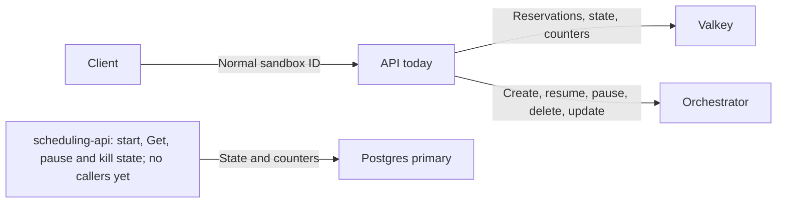
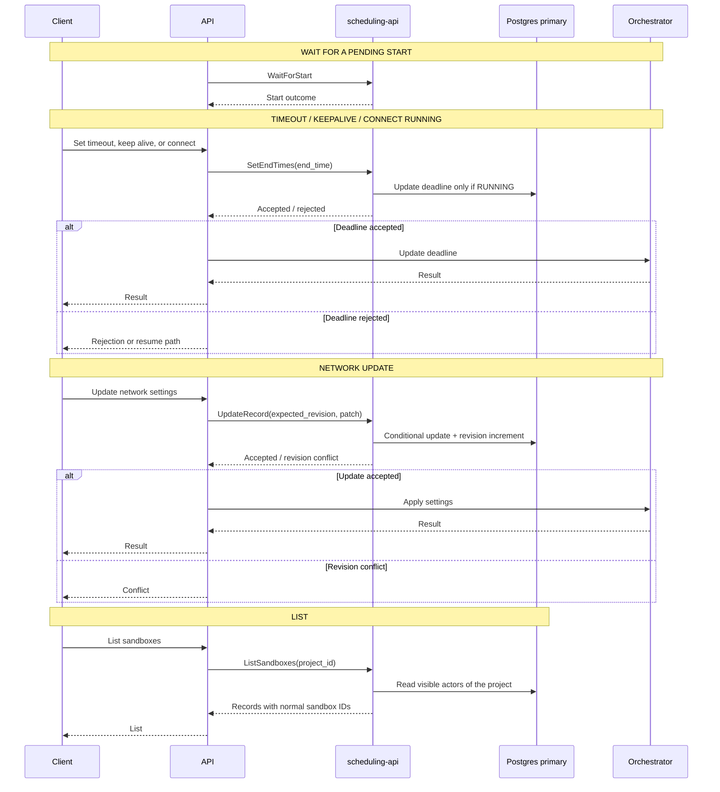
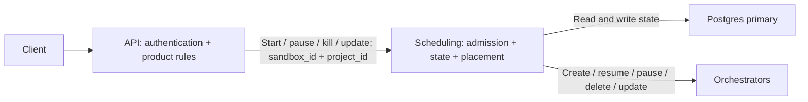

# Scheduling request flows

## Current flow

The API owns sandbox state and node calls today. scheduling-api implements the
start path, `Get`, and pause and kill (see below), but no service calls it yet.



## Implemented: start and read

`Reserve`, `Put`, `FinishStart` and `Get` are implemented. The
[README](../README.md#methods) gives their outcomes and error codes. During
migration, the API still selects nodes and calls the orchestrator. Scheduling
owns admission and state; all reads and writes use the **Postgres primary**.

Every request carries `project_id` and `sandbox_id`. IDs at this boundary are
normal sandbox IDs: scheduling converts them to internal actor UUIDs and back.
A request never reads or changes a sandbox of another project.

```mermaid
sequenceDiagram
    participant Client
    participant API
    participant Scheduling as scheduling-api
    participant DB as Postgres primary
    participant Node as Orchestrator

    Note over Client,Node: START / RESUME
    Client->>API: Create or resume
    API->>Scheduling: Reserve(project_id, sandbox_id, reservation_id, limit, end_time)
    Scheduling->>DB: Check admission; set STARTING + increment counter slot, one transaction
    Scheduling-->>API: RESERVED / ALREADY_PENDING / ALREADY_RUNNING / LIMIT_EXCEEDED / FINISHED
    alt RESERVED
        API->>Node: Place + create or resume
        alt Node started
            Node-->>API: Record
            API->>Scheduling: Put(reservation_id, record)
            Scheduling->>DB: Insert actor + set RUNNING, one transaction
            Scheduling-->>API: STORED / NOT_FOUND
            API-->>Client: Started (on NOT_FOUND: remove the sandbox, fail)
        else Node start failed
            Node-->>API: Failure
            API->>Scheduling: FinishStart(reservation_id, failure)
            Scheduling->>DB: Set GONE + keep failure + decrement the same slot, one transaction
            Scheduling-->>API: FINISHED / NOT_FOUND / ALREADY_STORED
            API-->>Client: Start failed
        end
    else ALREADY_PENDING
        API-->>Client: Start in progress (no wait method yet)
    else ALREADY_RUNNING
        API-->>Client: Existing sandbox from the response
    else LIMIT_EXCEEDED
        API-->>Client: Reject
    else FINISHED
        API-->>Client: This start has ended (failure from the response, if any)
    end

    Note over Client,DB: READ
    Client->>API: Get sandbox
    API->>Scheduling: Get(project_id, sandbox_id)
    Scheduling->>DB: Read a RUNNING or transitioning actor of the project
    Scheduling-->>API: Sandbox with normal sandbox ID, or none
    API-->>Client: Sandbox or not found
```

If `Put` fails after the VM exists, the API must kill the VM and reconcile the
record's unknown commit outcome. An RPC failure does not prove a transaction
rolled back; `FinishStart` is not a guaranteed rollback for a failed `Put`.

Not implemented yet:

- No sweeper ends a start whose caller never calls `Put` or `FinishStart`. Such
  a start stays STARTING and keeps counting against the project limit.
- No sweeper deletes GONE tombstones.
- No wait method for `ALREADY_PENDING`.

## Implemented: pause and kill

`BeginTransition`, `FinishTransition`, `RestoreRunning` and
`WaitForTransition` are implemented. The
[README](../README.md#pause-and-kill) gives their outcomes. The API still
calls the node; scheduling stores the state. There is no streaming.
Transition ownership is stored in PostgreSQL. Watchers are local to each
replica; callers can wait on any replica. On each replica, the calls for one
transition share one watch. It reads at once, and then every 25 ms to 500 ms,
more slowly as the transition gets older. The
[README](../README.md#pause-and-kill) gives the schedule. `max_wait` is the
budget of one call, up to 5 s. When it passes, the call returns `WAITING` from
the last read, which can lag by a polling delay plus the database read time.
The request also respects the caller deadline and the 10 s server default.

```mermaid
sequenceDiagram
    participant A as API caller A
    participant B as API caller B
    participant Scheduling as scheduling-api (any replica)
    participant DB as Postgres primary
    participant Node as Orchestrator

    A->>Scheduling: BeginTransition(transition_id T1, pause or kill, expected_execution_id?)
    Scheduling->>DB: RUNNING to PAUSING / KILLING with T1, atomic state change
    Scheduling-->>A: STARTED + sandbox (node, execution)
    par Owner calls the node
        A->>Node: Pause or delete
        alt The sandbox has ended on the node
            Node-->>A: Done, or failed with the VM removed
            A->>Scheduling: FinishTransition(T1, failure?)
            Scheduling->>DB: Delete record + set GONE + decrement the same slot, one transaction
            Scheduling-->>A: FINISHED / NOT_FOUND / RESTORED
        else The node refused the pause; the sandbox runs
            Node-->>A: Refused
            A->>Scheduling: RestoreRunning(T1, retry_after)
            Scheduling->>DB: PAUSING to RUNNING + retry window, one statement
            Scheduling-->>A: RESTORED / NOT_FOUND / NOT_RESTORABLE / ALREADY_FINISHED
        else Unknown node outcome
            Note over A,Node: Do not finish. Reconcile with the node first.
        end
    and Other API waits
        B->>Scheduling: BeginTransition(transition_id T2, same action)
        Scheduling-->>B: JOINED + transition_id T1 (CONFLICT for the other action)
        loop Until the outcome is not WAITING
            B->>Scheduling: WaitForTransition(T1, max_wait up to 5 s)
            Scheduling->>DB: One shared read per transition and replica, 25 ms to 500 ms apart, no connection held between reads
            Scheduling-->>B: WAITING / FINISHED / RESTORED / UNKNOWN / NOT_FOUND
        end
    end
```

A gRPC failure of `FinishTransition` or `RestoreRunning` does not roll the
transition back. The owner retries with the same transition ID.

Not implemented yet:

- No sweeper ends a transition whose owner never calls `FinishTransition` or
  `RestoreRunning`. The sandbox stays pausing or killing and waiters get
  `WAITING`.
- No method begins a snapshot.
- Replicas do not share reads, and no notification wakes a waiter: a
  transition is seen at the next read of the watch.

## Proposed: the other methods

**The methods below are proposed, not implemented or final.** They follow the
same rules as the start path: optimistic revision checks and transition IDs
reject stale writes and identify retries. The diagrams show only the key
arguments.



Unknown node outcomes and failures after a state write also need
reconciliation, not an assumed successful transition. A connect that needs
resume follows the start path above.

## Later scheduling-owned flow

The agreed later direction moves placement and node calls into scheduling. The
API keeps authentication and product rules. Labels below describe operations;
the final high-level RPC names have not been chosen.


