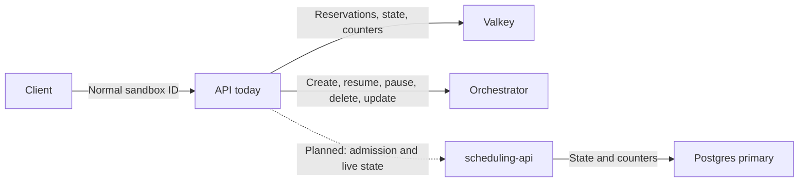
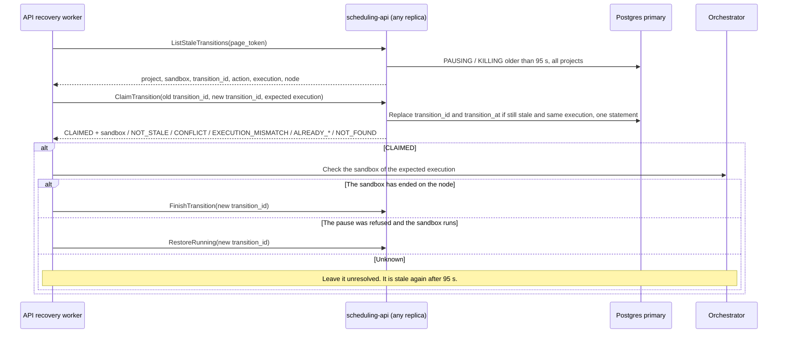
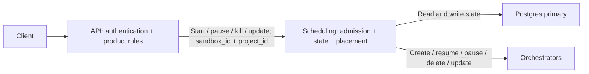

# Scheduling request flows

## Current flow

The API owns node calls and uses Redis for state and admission.
The scheduling-api RPCs are implemented. API integration is planned in a
separate change. The sequence diagrams below describe the intended callers
of those RPCs, not an existing API backend.



## Implemented: start and read

`Reserve`, `Put`, `FinishStart` and `Get` are implemented. The
[README](../README.md#methods) gives their outcomes and error codes. During
migration, the planned integration keeps node selection and orchestrator calls
in the API. Scheduling owns admission and state; all reads and writes use the
**Postgres primary**.

Every request carries `project_id` and `sandbox_id`. IDs at this boundary are
normal sandbox IDs: scheduling converts them to internal actor UUIDs and back.
A request never reads or changes a sandbox of another project.

```mermaid
sequenceDiagram
    participant Client
    participant API
    participant Scheduling as scheduling-api
    participant DB as Postgres primary
    participant Node as Orchestrator

    Note over Client,Node: START / RESUME
    Client->>API: Create or resume
    API->>Scheduling: Reserve(project_id, sandbox_id, reservation_id, limit, end_time)
    Scheduling->>DB: Check admission; set STARTING + increment counter slot, one transaction
    Scheduling-->>API: RESERVED + start_deadline / ALREADY_PENDING + start_deadline / ALREADY_RUNNING / LIMIT_EXCEEDED / FINISHED
    alt RESERVED
        Note over API,Node: Finish with Put or FinishStart before start_deadline (reserved_at + 90 s, database clock)
        API->>Node: Place + create or resume
        alt Node started
            Node-->>API: Record
            API->>Scheduling: Put(reservation_id, record)
            Scheduling->>DB: Insert actor + set RUNNING, one transaction
            Scheduling-->>API: STORED / NOT_FOUND
            API-->>Client: Started (on NOT_FOUND: remove the sandbox, fail)
        else Node start failed
            Node-->>API: Failure
            API->>Scheduling: FinishStart(reservation_id, failure)
            Scheduling->>DB: Set GONE + keep failure + decrement the same slot, one transaction
            Scheduling-->>API: FINISHED / NOT_FOUND / ALREADY_STORED
            API-->>Client: Start failed
        end
    else ALREADY_PENDING
        API->>Scheduling: InspectReservation, checking the reservation ID until it ends
        API-->>Client: Started or the start failure
    else ALREADY_RUNNING
        API-->>Client: Existing sandbox from the response
    else LIMIT_EXCEEDED
        API-->>Client: Reject
    else FINISHED
        API-->>Client: This start has ended (failure from the response, if any)
    end

    Note over Client,DB: READ
    Client->>API: Get sandbox
    API->>Scheduling: Get(project_id, sandbox_id)
    Scheduling->>DB: Read a RUNNING or transitioning actor of the project
    Scheduling-->>API: Sandbox with normal sandbox ID, or none
    API-->>Client: Sandbox or not found
```

If `Put` fails after the VM exists, the API must kill the VM and reconcile the
record's unknown commit outcome. An RPC failure does not prove a transaction
rolled back; `FinishStart` is not a guaranteed rollback for a failed `Put`.

Not implemented yet:

- No wait method for `ALREADY_PENDING`.

A background worker cleans up, on one replica at a time (see the
[README](../README.md#background-cleanup)):

- A start that is still STARTING 90 s after `reserved_at` is ended: GONE with
  `start timed out`, code 4, and the same slot decremented, in one
  transaction that rechecks the project, reservation ID, state and age. After
  it, a late `Put` returns `NOT_FOUND` and the API must remove the sandbox on
  the node; the cleanup does not stop it.
- GONE rows older than 5 minutes after `gone_at` are deleted in bounded
  batches, without changing counters. While a gone row remains and no new
  attempt has replaced it, repeated calls get the terminal outcome. After the
  purge, finish, wait and begin calls return `NOT_FOUND`, and `Reserve` with
  the old reservation ID starts a new attempt, so the API must stop retrying
  with one reservation ID within that time.

## Implemented: pause and kill

`BeginTransition`, `FinishTransition`, `RestoreRunning` and
`WaitForTransition` are implemented. The
[README](../README.md#pause-and-kill) gives their outcomes. In the planned
integration, the API calls the node; scheduling stores the state. There is no
streaming.
Transition ownership is stored in PostgreSQL. Watchers are local to each
replica; callers can wait on any replica. On each replica, the calls for one
transition share one watch. It reads at once, and then every 25 ms to 500 ms,
more slowly as the transition gets older. The
[README](../README.md#pause-and-kill) gives the schedule. `max_wait` is the
budget of one call, up to 5 s. When it passes, the call returns `WAITING` from
the last read, which can lag by a polling delay plus the database read time.
The request also respects the caller deadline and the 10 s server default.

```mermaid
sequenceDiagram
    participant A as API caller A
    participant B as API caller B
    participant Scheduling as scheduling-api (any replica)
    participant DB as Postgres primary
    participant Node as Orchestrator

    A->>Scheduling: BeginTransition(transition_id T1, pause or kill, expected_execution_id?)
    Scheduling->>DB: RUNNING to PAUSING / KILLING with T1, atomic state change
    Scheduling-->>A: STARTED + sandbox (node, execution)
    par Owner calls the node
        A->>Node: Pause or delete
        alt The sandbox has ended on the node
            Node-->>A: Done, or failed with the VM removed
            A->>Scheduling: FinishTransition(T1, failure?)
            Scheduling->>DB: Delete record + set GONE + decrement the same slot, one transaction
            Scheduling-->>A: FINISHED / NOT_FOUND / RESTORED
        else The node refused the pause; the sandbox runs
            Node-->>A: Refused
            A->>Scheduling: RestoreRunning(T1, retry_after)
            Scheduling->>DB: PAUSING to RUNNING + retry window, one statement
            Scheduling-->>A: RESTORED / NOT_FOUND / NOT_RESTORABLE / ALREADY_FINISHED
        else Unknown node outcome
            Note over A,Node: Do not finish. Reconcile with the node first.
        end
    and Other API waits
        B->>Scheduling: BeginTransition(transition_id T2, same action)
        Scheduling-->>B: JOINED + transition_id T1 (CONFLICT for the other action)
        loop Until the outcome is not WAITING
            B->>Scheduling: WaitForTransition(T1, max_wait up to 5 s)
            Scheduling->>DB: One shared read per transition and replica, 25 ms to 500 ms apart, no connection held between reads
            Scheduling-->>B: WAITING / FINISHED / RESTORED / UNKNOWN / NOT_FOUND
        end
    end
```

A gRPC failure of `FinishTransition` or `RestoreRunning` does not roll the
transition back. The owner retries with the same transition ID.

Not implemented yet:

- No caller recovers a transition whose owner never calls `FinishTransition`
  or `RestoreRunning`. The sandbox stays pausing or killing and waiters get
  `WAITING`. The recovery methods below exist, but nothing calls them yet.
- No method begins a snapshot.
- Replicas do not share reads, and no notification wakes a waiter: a
  transition is seen at the next read of the watch.

## Implemented: stale transition recovery methods

`ListStaleTransitions` and `ClaimTransition` are implemented, but no service
calls them and scheduling never calls a node. The
[README](../README.md#stale-transitions) gives their outcomes. A transition
is stale 95 s after it began or was last claimed; that makes it a candidate,
not proof that its owner has stopped. The intended recovery caller is a
trusted API worker:



The claim prevents only `FinishTransition` and `RestoreRunning` with the old
transition ID from changing the claimed attempt. It does not cancel a node
call that the old owner still runs, and it does not permanently reject
`BeginTransition` with the old ID: after the new owner restores the sandbox
to running, an old `BeginTransition` can start another operation. The API's
retries of `BeginTransition` must therefore stop before 95 s after the first
attempt. Waiters with the old ID get `UNKNOWN`; they reread the sandbox with
`Get` and reassess, and do not use `BeginTransition` as a lookup. The
orchestrator calls must be shown to be safe to repeat and limited to the
expected execution before an automatic recovery uses these methods.
Automatic recovery is not approved yet.

## Implemented: deadline, list and snapshot-deletion claims

`InspectReservation` lets a start joiner poll the current reservation ID and
its outcome. It does not retain the history of replaced reservations.
`UpdateDeadline` requires the expected execution and previous deadline. A
concurrent transition or deadline update rejects the write. The caller sends
the node update only after the state write succeeds.

```mermaid
sequenceDiagram
    participant Client
    participant API
    participant Scheduling as scheduling-api
    participant DB as Postgres primary
    participant Node as Orchestrator

    Note over Client,Node: TIMEOUT / KEEPALIVE / CONNECT RUNNING
    Client->>API: Set timeout, keep alive, or connect
    API->>Scheduling: UpdateDeadline(expected_execution_id, expected_end_time, end_time)
    Scheduling->>DB: Compare execution and deadline while RUNNING; cap lifetime
    Scheduling-->>API: Updated sandbox / FAILED_PRECONDITION
    alt Deadline accepted
        API->>Node: Update deadline
        Node-->>API: Result
        API-->>Client: Result
    else Deadline rejected
        API-->>Client: Rejection or resume path
    end

    Note over Client,DB: LIST
    Client->>API: List sandboxes
    API->>Scheduling: ListLive(project_id, states, expired_only, page_token)
    Scheduling->>DB: Read visible actors of the project
    Scheduling-->>API: Records with normal sandbox IDs
    API-->>Client: List
```

Unknown node outcomes and failures after a state write also need
reconciliation, not an assumed successful transition. A connect that needs
resume follows the start path above.

`ClaimSnapshotDeletion(project_id, sandbox_id, claim_id)` claims an absent or
gone sandbox for 60 seconds. It excludes new reservations for the same project while the caller
deletes the paused snapshot. Different claim IDs can coexist. Retrying a claim renews only its expiry.
`ReleaseSnapshotDeletionClaim` releases only the matching project, sandbox and claim ID.
Reservations remain blocked until all active claims for that project and sandbox are released or expire.
Claims from another project cannot block admission after the gone row is purged.
An existing live run or a gone row owned by another project still prevents a claim.
The claim does not add a live sandbox or consume a limit slot. Tombstone cleanup also removes expired claims in bounded batches.

Network record updates and lifecycle holds are not implemented. The proposed
`UpdateRecord` operation needs its own concurrency contract before callers can
use it.

## Later scheduling-owned flow

The agreed later direction moves placement and node calls into scheduling. The
API keeps authentication and product rules. Labels below describe operations;
the final high-level RPC names have not been chosen.


